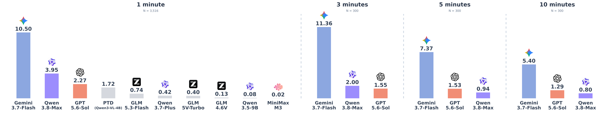

# Event-STVG: Spatio-Temporal Video Grounding for Long-Form Event Reasoning

[Paper (arXiv:2610.22444)](https://arxiv.org/abs/2610.22444) · [PDF](https://arxiv.org/pdf/2610.22444) · [Code](https://github.com/THU-KEG/EventSTVG) · [Dataset](https://huggingface.co/datasets/zacharyz21/EventSTVG)

Yizhe Zhang, Xujia Wang, Songqi Tang, Xujie Tang, Leo Jiahao Jiang, Jiacheng Wang, Bowen Qu, JinBo Li, Qin Wang, Ji Qi, Lei Hou, Bin Xu, Juanzi Li.

EventSTVG studies **event localization and the spatial grounding of semantic roles** in video. A query identifies an event and its participants by their roles; a prediction localizes the event in time and tracks the same participant for each requested role.

This first release contains the **SoccerSTVG football component**: **3,516 target events from 50 matches**, 17 event types and 16 role types, forming 6,497 event–role instances. Oracle and 1/3/5/10-minute settings share the same event IDs. Together they form 17,580 evaluation instances, not 17,580 distinct events. The multi-domain extension is pending release.

**Dataset:** [zacharyz21/EventSTVG on Hugging Face](https://huggingface.co/datasets/zacharyz21/EventSTVG). Videos and final annotations are maintained there. Dataset access currently requires requesting approval on the HF page and signing in with an approved account. The [paper](https://arxiv.org/abs/2610.22444) describes the full benchmark of 4,016 event occurrences across soccer and seven additional domains; the current public release contains the 3,516-event soccer component described above.

## Current Model Performance on EventSTVG



*Performance on SoccerSTVG, measured by m-vIoU (%).*

See [baseline protocols and reproduction details](baselines/README.md) and [numerical results](baselines/results/).

## Getting Started

Install with Python 3.10 or later:

```bash
python -m pip install -r requirements.txt
```

The compact evaluator uses only the Python standard library. Matplotlib and pytest support the original report CLI and regression suite. Optional API baseline dependencies are in `baselines/requirements-api.txt`; local model requirements and access limitations are described in [baselines/README.md](baselines/README.md).

Videos and full annotations belong on Hugging Face. GitHub contains code, documentation and three small annotation/prediction examples per setting, without video files. Each HF setting has one integrated `soccerstvg/videos/<setting>/metadata.jsonl`, carrying video association, complete prompt and annotations. Read [data_format.md](docs/data_format.md) before constructing model inputs: annotations and source timing are withheld evaluation information.

Request access on the [HF dataset page](https://huggingface.co/datasets/zacharyz21/EventSTVG), then install and sign in. Download **metadata only** by default:

```bash
hf auth login
python scripts/download_data.py --repo-id zacharyz21/EventSTVG \
  --setting context_1min --local-dir data
```

Add `--sample-id 'EXACT_EVENT_ID'` to fetch only that event's video. Repeating this flag fetches an explicitly chosen subset. The script never defaults to downloading all videos or all five settings (the existing video collection is approximately 1.31 TB). See [data access instructions](docs/data_format.md) for revision pinning and local loading.

Run an evaluation example from this directory, without a model or video download:

```bash
python evaluation/evaluate.py \
  --metadata examples/context_1min.metadata.jsonl \
  --predictions examples/predictions/copy_gt/context_1min.jsonl \
  --setting context_1min --model copy_gt --out artifacts/quickstart.json
python scripts/verify_examples.py
```

Expected results for each example are stored in [examples/expected_scores.json](examples/expected_scores.json). `copy_gt` is a synthetic interface check; it is not a model baseline.

The official metric implementation is `role_stvg_eval_v1.0`, with frozen parser `role_stvg_json_extraction_v1`. Roles are matched by identity, thresholds use strict `>`, and missing/failed predictions remain in the GT denominator. The historical RoleSTVG package names, identifiers and sample IDs are preserved for reproducibility; EventSTVG is the release name. [Evaluation documentation](docs/evaluation.md) includes input contracts, formulas, failure handling and separate commands for all five settings.

[Annotation documentation](docs/annotation.md) describes the actual human annotation and quality review evidence, with unconfirmed facts listed explicitly. [Baseline documentation](baselines/README.md) covers existing API and local implementations, recorded model aliases, media preprocessing, matched 300-event comparisons, and known reproduction gaps. Scores reproduced from existing responses are distinguished from projected or partial observations.

## Citation

If you use Event-STVG, please cite the [paper](https://arxiv.org/abs/2610.22444):

```bibtex
@misc{zhang2026eventstvgspatiotemporalvideogrounding,
  title={Event-STVG: Spatio-Temporal Video Grounding for Long-Form Event Reasoning},
  author={Yizhe Zhang and Xujia Wang and Songqi Tang and Xujie Tang and Leo Jiahao Jiang and Jiacheng Wang and Bowen Qu and JinBo Li and Qin Wang and Ji Qi and Lei Hou and Bin Xu and Juanzi Li},
  year={2026},
  eprint={2610.22444},
  archivePrefix={arXiv},
  primaryClass={cs.CV},
  url={https://arxiv.org/abs/2610.22444},
}
```

## License

**License:** the existing data-card label **CC BY-NC 4.0** is provisionally retained for newly contributed annotations, subject to confirmation of ownership and scope. SoccerNet match footage and other upstream content retain their own rights and access conditions; this project does not relicense them. Commercial use requires authorization from relevant rights holders. **Code license is undecided** and is not covered by the data-card license. See [LICENSE_SCOPE.md](LICENSE_SCOPE.md).
